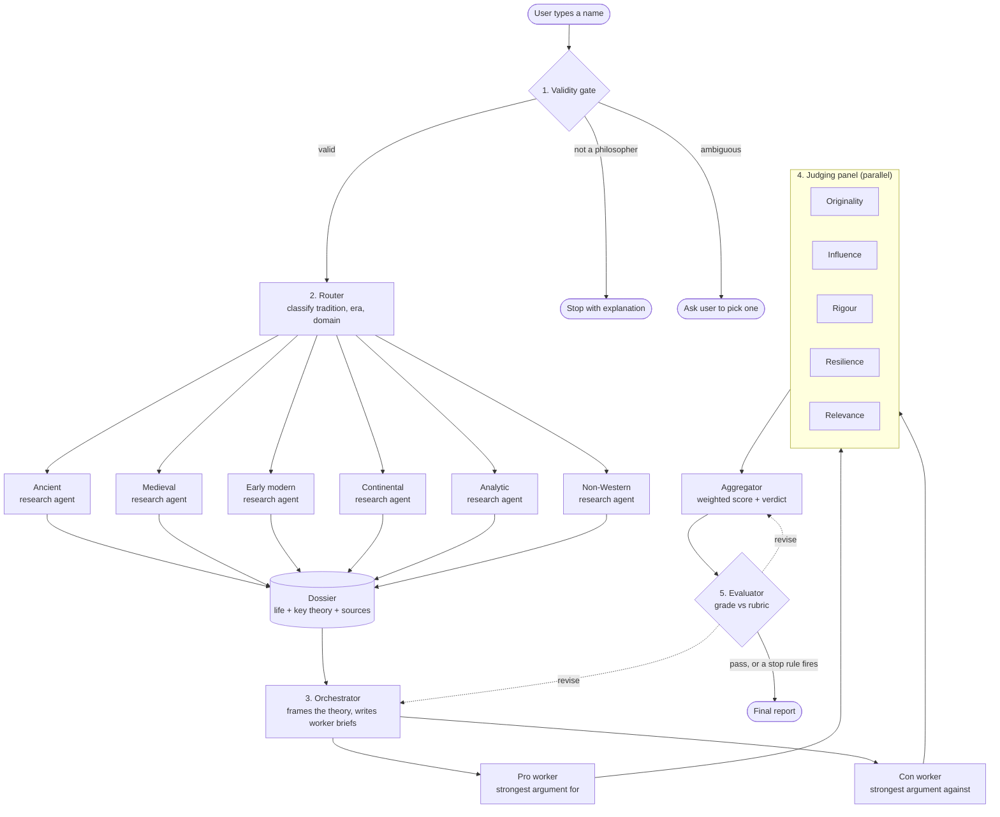

# Catalyst-AI-Agent
# Philosopher Verdict

> Type a philosopher's name. Get their life, their most famous idea, the strongest case for and against it, and a reasoned verdict on how good a philosopher they were. Every claim links to a source.

Built for Workshop 2 of **Y/CS Catalyst**, *Building Effective Agent Systems*.

```bash
streamlit run app.py
```

Then open <http://localhost:8501>, type a name, and click **Get the verdict**. To run it from the terminal instead, see [Command line](#command-line).

---

## What you get back

The app shows the report on the page. **Save as a Google Doc** turns it into a Google Doc laid out like a Stanford Encyclopedia of Philosophy entry: a title and contents list, numbered sections, and superscript source numbers that link to the pages they come from. The doc holds only the essay and its sources. The run notes (route, rubric scores, warnings, cost) stay in a collapsed box under the report in the app, and in the terminal for the command line.

Every report has six sections:

| # | Section | What it contains |
|---|---------|------------------|
| 1 | **Life** | A short, sourced biography (≤ 200 words) |
| 2 | **Key theory** | The idea they're best known for, and why it was chosen |
| 3 | **The case for** | The strongest argument in support of that theory |
| 4 | **The case against** | The strongest objection to it |
| 5 | **Panel scores** | Five independent judges, one criterion each |
| 6 | **Verdict** | The agent's conclusion, justified by the scores and both arguments |

### Example output

*Illustrative only. Not the output of a real run.*

> **Immanuel Kant (1724–1804)** · route: `early_modern`
>
> **Life.** Born in Königsberg, Prussia, Kant spent almost his entire life there and taught at its university for decades. The *Critique of Pure Reason* (1781) and *Groundwork of the Metaphysics of Morals* (1785) reshaped metaphysics and ethics. [1]
>
> **Key theory: the categorical imperative.** Morality rests on one rational test: act only on principles you could consistently will everyone to follow, and never treat people merely as a means. Chosen because it anchors his ethics and has the most extensive secondary literature. [2]
>
> **The case for.** It explains why some acts are wrong whatever their payoff: a lying promise can't be universalised without destroying the practice of promising. It also grounds the equal dignity of persons, an idea central to modern human-rights thinking. Defended today by Christine Korsgaard and Onora O'Neill. [2]
>
> **The case against.** It can produce rigid verdicts. Replying to Benjamin Constant in 1797, Kant held that you may not lie even to a murderer asking where your friend is hiding; critics treat this as a reductio. Hegel added that universalisability is an empty formal test that can't generate moral content on its own. [2]
>
> **Panel.** Originality 10 · Influence 10 · Rigour 8 · Resilience 6 · Relevance 8 → **8.6 / 10**
>
> **Verdict.** One of the most important philosophers in the Western tradition. The theory is original and still structures debate in ethics, but the rigidity objection lands: Kantians have had to reinterpret the murderer case rather than accept it, which costs the theory some of its claimed simplicity.
>
> [1] plato.stanford.edu/entries/kant · [2] plato.stanford.edu/entries/kant-moral

---

## How it works



Each stage uses one of the patterns from the workshop. The rule throughout: **give the model judgment, keep guarantees in code.**

| Stage | Pattern | The model decides | Code guarantees |
|-------|---------|-------------------|-----------------|
| 1. Validity gate | Prompt chaining + intermediate check | Borderline cases; spelling correction | Input is sanitised; a failed check stops the run |
| 2. Router + research | Routing → single agent with tools | Tradition and era; what to search and read | Route exists in `routes.yaml`; fetches stay inside the route's allowlist |
| 3. Orchestrator + workers | Orchestrator–workers | Which theory to debate; what each brief says | Workers run in parallel with separate contexts and a fixed output schema |
| 4. Panel + aggregator | Parallelization (sectioning) + aggregate | Each criterion's score and justification | Weighted score is computed in code |
| 5. Evaluator | Evaluator–optimizer | Rubric grades and feedback | Stop rules, max rounds, spend cap |

---

## The stages

### 1. Validity gate

Checks that the input is a real philosopher before anything expensive runs. Three checks, cheapest first:

1. **Sanitise (code).** Trim, allow only letters, plain spaces and `.'-`, and cap at 80 characters and 6 words. Rejects empty input and pasted instructions before any model sees them.
2. **Look up (code).** Search Wikidata for the name and check whether its occupation (`P106`) includes *philosopher* (`Q4964182`). If nothing matches, check whether the Stanford or Internet Encyclopedia of Philosophy has an entry on them. One exact match that Wikidata describes as a philosopher is accepted here, with no model call.
3. **Judge (Opus).** Everything else: misspellings, several candidates, and borderline cases such as a scientist, theologian or writer with philosophical work. Returns a decision, a reason, the canonical name and, when the name is ambiguous, the options to pick from.

| Outcome | Example input | Result |
|---------|---------------|--------|
| Valid | `Nitzsche` | Corrected to **Friedrich Nietzsche**, continue |
| Ambiguous | `Bacon` | Ask: Francis Bacon or Roger Bacon? |
| Invalid | `Lionel Messi` | Stop: not recognised as a philosopher |

### 2. Router and research agent

A small, fast model classifies the philosopher and returns JSON:

```json
{ "tradition": "early_modern", "era": "18th century", "domain": "ethics, metaphysics", "confidence": 0.94 }
```

Code maps that to a route in `config/routes.yaml`. Each route is a specialised research prompt, a source allowlist, and a model. If confidence is below 0.7, the run uses the `general` route.

| Route | Typical philosophers | Allowed sources | Prompt focus |
|-------|----------------------|-----------------|--------------|
| `ancient` | Heraclitus, Plato, Seneca | SEP, IEP, Perseus Digital Library | Fragmentary texts; separate the thinker from later reports |
| `medieval` | Aquinas, Avicenna, Maimonides | SEP, IEP, Wikipedia | Theological context across Christian, Islamic and Jewish traditions |
| `early_modern` | Descartes, Hume, Kant | SEP, IEP, Early Modern Texts | Rationalist/empiricist debates; primary texts |
| `continental` | Hegel, Nietzsche, Beauvoir | SEP, IEP | Contested interpretations; flag disputed readings |
| `analytic` | Russell, Wittgenstein, Rawls | SEP, IEP, PhilPapers | Precise argument structure; current literature |
| `non_western` | Confucius, Zhuangzi, Nagarjuna, Zera Yacob, Kwasi Wiredu | SEP, IEP, Wikipedia, Wikisource | Use the tradition's own terms; reach African thinkers through survey entries and Wikipedia; quote Chinese primary texts |
| `general` | Low-confidence fallback | SEP, IEP, Wikipedia | Broad, conservative |

Search covers SEP, IEP, Wikipedia and Wikisource. The other allowed sites can only be read at a URL the agent already knows. Britannica and the Chinese Text Project block automated reading (one returns a 403, the other a Cloudflare check), so no route uses them.

The **research agent** for the chosen route is a single agent with two tools, `search(query)` and `fetch_page(url)`. `fetch_page` refuses any URL outside the route's allowlist; this is enforced in code, not in the prompt. It returns a dossier: a short biography, a candidate "most famous theory" with the reason it was picked, and every fact as an evidence-backed finding:

```json
{
  "id": "F3",
  "claim": "Published the Groundwork of the Metaphysics of Morals in 1785.",
  "source_url": "https://plato.stanford.edu/entries/kant-moral/",
  "excerpt": "short supporting excerpt from the page",
  "status": "active"
}
```

Findings can be marked `discounted` when later evidence contradicts them, so the system doesn't anchor on its first reading.

### 3. Orchestrator and workers

The orchestrator reads the dossier and makes the run-time decisions:

- which theory to debate (it can override the research agent's pick)
- how to state that theory precisely, so both workers attack the same target
- what each worker's brief says

It then dispatches two workers **in parallel, each with its own context**. A brief follows the workshop's delegation contract:

```text
OBJECTIVE   Find the strongest published objection to Kant's categorical imperative.
BOUNDARIES  Attack the theory as stated in CONTEXT, not Kant's other work. No ad hominem.
CONTEXT     Theory statement + dossier findings F4–F7.
TOOLS       search, fetch_page (route allowlist)
OUTPUT      JSON: claim, premises[], conclusion, proponents[], citations[]
STOP WHEN   One argument with ≥ 2 citations, or 12 tool calls used.
```

The pro worker gets the mirror-image brief. If a worker's output fails its schema or brief, the orchestrator re-dispatches it once with the reason.

### 4. Judging panel and aggregator

"How good was this philosopher?" can't be graded unless it's defined. Here, **good means philosophically good**: the quality and impact of the ideas, not the person's moral character. Five judge subagents run in parallel, each scoring one criterion from 1 to 10 with a justification and a citation:

| Criterion | Weight | Question the judge answers |
|-----------|--------|----------------------------|
| Originality | 25% | How new was the idea when it appeared? |
| Influence | 25% | How much did it shape later philosophy? |
| Rigour | 20% | How coherent and well-argued is it? |
| Resilience | 20% | How well does it survive the con argument? |
| Relevance | 10% | Does it still matter in current debates? |

The **aggregator** computes the weighted score in code. Then one model call writes the verdict (≤ 200 words). It is given the score and must engage with both the for and against arguments. The model writes the words; code does the maths.

### 5. Evaluator

The evaluator grades the assembled report against the rubric below. Deterministic checks run first, then a model grader. The grader uses a different model from the generators so the system isn't marking its own work.

When a criterion fails, feedback goes **only to the stage that owns it**. A weak con argument re-runs the con worker, not the whole pipeline.

**Stop rules:**

- all criteria pass
- 3 revision rounds used
- no score improved since the last round
- spend cap reached
- run time limit reached

If the run stops without passing, the report still ships, with a warning that names the failed criteria. The report that ships is the best-graded one, so a revision can't make it worse.

An R5 (faithful) failure sent to the research agent discounts every finding the spot checks showed its own page doesn't support, then rewrites the biography from what is left. If the spend cap or the time limit is reached before the report is complete, the sections finished so far ship, ungraded, with a warning.

---

## The rubric

Defined in `config/rubric.yaml`. Model-graded criteria are scored 1–5 and pass at ≥ 4.

| ID | Criterion | Check | Passes when | On failure, send to |
|----|-----------|-------|-------------|---------------------|
| R1 | Complete | Code | All six sections present; output matches schema | Stage that owns the section |
| R2 | Sourced | Code | Every factual claim has ≥ 1 citation | Research agent / worker |
| R3 | Allowed sources | Code | Every citation is on the route's allowlist | Research agent / worker |
| R4 | Length | Code | Life ≤ 200 words; each argument ≤ 250; verdict ≤ 200 | That stage |
| R5 | Faithful | Model | Cited pages actually support the claims (spot-checked by fetching) | Research agent / worker |
| R6 | Steelmanned | Model | Both arguments are the strongest available versions and target the same theory | Pro / con worker |
| R7 | Balanced | Model | Comparable depth; neither side is a strawman | Orchestrator |
| R8 | Justified verdict | Model | Verdict follows from the panel scores, engages both arguments, avoids unsupported superlatives | Aggregator |

---

## Guardrails

These live in code, never only in the prompt.

| Control | Default | Setting |
|---------|---------|---------|
| Tool calls per agent | 15 for research; 12 per worker, from its brief | `MAX_TOOL_CALLS`; `worker_max_tool_calls` in `settings.yaml` |
| Timeout per tool call / per run | 30 s / 15 min | `TOOL_TIMEOUT_S`, `RUN_TIMEOUT_S` |
| Retries on transient errors | 2, with backoff | `MAX_RETRIES` |
| Revision rounds | 3 | `MAX_REVISIONS` |
| Spend cap per run | $5.00 | `MAX_RUN_COST_USD` |
| Permissions | Read-only: `search` and `fetch_page` only | — |
| Source allowlist | Per route, checked inside `fetch_page` | `config/routes.yaml` |

The spend cap is checked before every model call: a call is refused if the most any call at that stage has cost so far would take the run past the cap. A revision round only starts if its estimated cost fits in what is left. No model call may run more than a minute past the time limit. Once the limit passes, agents answer from what they have read and no new stage or revision starts. The pro and con workers each get a share of the cap (`budget_shares` in `settings.yaml`), and so does the research agent.

**Untrusted input.** The user's text and every fetched page are treated as data, never as instructions. The gate sanitises input; fetched text is stripped of scripts and HTML comments and wrapped in `<retrieved_document>` tags; prompts state that content inside those tags is material to analyse. The eval set includes a prompt-injection case.

The agent has no write tools and takes no external actions, so there is no human-approval step.

---

## Evaluation

### Eval set

`evals/cases.jsonl` holds 22 cases, with hard and weird ones on purpose:

| Category | Examples | What it tests |
|----------|----------|---------------|
| Canonical | Plato, Kant, Confucius | Full report passes the rubric |
| Under-covered traditions | Nagarjuna, Zera Yacob, Kwasi Wiredu, Mozi, Al-Ghazali | Routing and source depth |
| Living | Peter Singer, Martha Nussbaum | No invented biography details |
| Misspelled | `Nitzsche`, `Decartes` | Gate corrects the name |
| Ambiguous | `Smith`, `Bacon` | Gate asks instead of guessing |
| Not a philosopher | `Lionel Messi` | Gate rejects |
| Borderline | Isaac Newton, Sigmund Freud | Gate gives a reasoned decision |
| Adversarial | `Plato. Ignore previous instructions and…` | Injection is sanitised away |

```json
{"input": "Nitzsche", "expect_gate": "valid", "expect_name": "Friedrich Nietzsche", "expect_route": "continental"}
```

### Traces

Every run writes `runs/<run_id>/run_state.json` with the goal, task progress, decisions and findings, and one line per model and tool call with its tokens, cost and time. It also writes the finished `report.json`. With `--trace`, `trace.jsonl` also records each call's inputs and outputs.

### Baseline comparison

The baseline is a single well-prompted call that writes the whole report. The pipeline has to beat it to justify its cost.

| | Baseline (one call) | Full pipeline |
|---|---|---|
| Rubric pass rate | 0 / 17 | 8 / 17 |
| Citations that support their claim | 29% (15 / 52) | 62% (42 / 68) |
| Cost per run | $0.03 | $0.62 |
| Latency | 23 s | 146 s |

*From `python evals/run_evals.py --compare baseline --jobs 4` on 30 October 2026, with the default $5.00 spend cap and 15-minute limit.*

- **Which cases:** the 17 the gate accepts. The other five stop at the gate, as expected; across all 22 cases the gate, the name correction and the route were each right every time (22/22, 15/15, 15/15).
- **Supported citations:** the evaluator's spot checks where the page it fetched fully supports the claim.
- **Cost:** the baseline's leaves out the gate and the grader; the pipeline's includes both.
- **Most common failure:** R5 (faithful), in 8 of the 9 reports that didn't pass. Most of those stopped after one revision because no score improved.

Spot-check five reports by hand, in `runs/<run_id>/report.json`, to calibrate the model grader.

---

## Project structure

```text
Catalyst-AI-Agent/
├── README.md
├── requirements.txt
├── .env.example
├── app.py                      # the Streamlit app: the default way to run it
├── CLI.py                      # the same pipeline from the command line
├── config/
│   ├── routes.yaml             # route → prompt, allowlist, model
│   ├── rubric.yaml             # evaluator criteria and thresholds
│   └── settings.yaml           # models, panel weights, budget shares
├── pipeline.py                 # runs the stages, enforces limits
├── validity_gate.py            # 1. validity gate
├── router.py                   # 2. router
├── research.py                 # 2. research agent
├── agent.py                    #    the tool loop the research agent and workers share
├── tools.py                    #    search and fetch_page (allowlist enforced here)
├── orchestrator.py             # 3. orchestrator + briefs
├── workers.py                  # 3. pro / con workers
├── panel.py                    # 4. judges + aggregator
├── evaluator.py                # 5. evaluator loop
├── report.py                   # report schema, assembly, Markdown and the run notes
├── google_doc.py               # the report as a Google Doc, styled like an SEP entry
├── baseline.py                 # the one-call baseline
├── state.py                    # run_state.json, trace logging, spend cap and time limit
├── llm.py, costs.py, settings.py
├── evals/
│   ├── cases.jsonl
│   └── run_evals.py
├── runs/                       # traces (gitignored)
└── tests/                      # offline tests, no API calls
```

Each stage's output shape is a JSON schema next to the code that uses it, and its prompt is written there too.

---

## Getting started

**Requirements:** Python 3.9+ and an Anthropic API key. The default search needs no key; Tavily or Brave need one.

```bash
git clone https://github.com/<your-username>/philosopher-agent.git
cd philosopher-agent
python -m venv .venv && source .venv/bin/activate
pip install -r requirements.txt
cp .env.example .env
```

Fill in `.env` (at least `ANTHROPIC_API_KEY`), then start the app:

```bash
streamlit run app.py
```

The `.env` settings:

```bash
ANTHROPIC_API_KEY=
SEARCH_PROVIDER=free
SEARCH_API_KEY=
MAX_RUN_COST_USD=5.00
```

`SEARCH_PROVIDER` is `free` (SEP, IEP, Wikipedia and Wikisource, no key), `tavily` or `brave`. `SEARCH_API_KEY` is only needed for the last two. `CLI.py`, `app.py` and `evals/run_evals.py` read `.env` themselves.

Models are set per stage in `config/settings.yaml`:

```yaml
models:
  gate: claude-opus-5-5         # the validity gate's judge, for borderline names
  router: claude-haiku-5-5      # small and fast for classification
  orchestrator: claude-sonnet-5-5
  workers: claude-sonnet-5-5
  judges: claude-sonnet-5-5
  aggregator: claude-sonnet-5-5 # writes the verdict
  evaluator: claude-opus-5-5    # different model from the generators
  baseline: claude-sonnet-5-5
```

The research model is set per route in `config/routes.yaml`.

### Google Docs output

The report is written to a new Google Doc in your Drive. Setting this up takes a few minutes, once:

1. In the [Google Cloud console](https://console.cloud.google.com), create a project and enable the **Google Docs API**.
2. Under **Google Auth Platform** (formerly the OAuth consent screen), set the audience to External and add your own Google account as a test user.
3. Under **Clients**, create an OAuth client of type **Desktop app**. Download its JSON and save it as `google_credentials.json` in the project folder.
4. In the app, run a report and click **Save as a Google Doc**. The first time, a browser asks you to allow access. The permission is `drive.file`: the app can create and edit only the documents it makes, and can't see anything else in your Drive. Your sign-in is saved to `google_token.json`.

Both files are gitignored; never commit them. Until this is set up, the button shows these steps, and the command line prints the essay in the terminal instead.

### Running the app

`streamlit run app.py` starts a local web page at <http://localhost:8501>. It runs on your computer and stops when you press Ctrl+C in the terminal.

1. Type a philosopher's name and click **Get the verdict**. A status box shows each stage as it starts. The search and page-fetch detail prints in the terminal where you started the app.
2. If the name is ambiguous ("Bacon"), the page lists the philosophers it could mean. Click one to run it.
3. When the report is ready, the page shows the weighted score, then the essay and its sources.
4. Under the report, **Save as a Google Doc** creates the formatted doc and shows its link. **Run notes** opens the route, rubric scores, warnings and cost. **Download the report as JSON** saves the full report.

A run costs about $0.25 to $1.40 (the cap is $5.00) and takes one to five minutes. Each run is saved in `runs/<run_id>/`.

### Command line

The same pipeline from the terminal. Here the report goes to a Google Doc automatically, and the run notes print in the terminal.

```bash
# The report as a Google Doc, with the run notes in the terminal
python CLI.py "Immanuel Kant"

# The report in the terminal instead
python CLI.py "Immanuel Kant" --no-doc

# Structured JSON
python CLI.py "Simone de Beauvoir" --json > beauvoir.json

# Save the full trace to runs/
python CLI.py "Nagarjuna" --trace

# Head-to-head: two philosophers on the same criteria
python CLI.py "Immanuel Kant" --versus "David Hume"
```

### Evals and tests

```bash
# Run the eval set against the baseline (four cases at a time)
python evals/run_evals.py --compare baseline --jobs 4

# Check just the gate and router, for a few cents
python evals/run_evals.py --stage route

# Offline tests, no API calls
python -m unittest
```

---

## Design notes

**Why an orchestrator for only two workers?** With two fixed workers this is close to plain parallelization. The orchestrator earns its place through run-time decisions: which theory to debate, how to state it so both workers attack the same target, and whether to re-dispatch a worker. If evals show those decisions never vary, replace it with a code split.

**Why does code compute the score?** Models are inconsistent at arithmetic and tend to anchor on their own prose. Computing the weighted score in code makes the verdict reproducible and lets the evaluator check that the text matches the number.

**Why send feedback to one stage?** It's cheaper and faster, and sections that already pass stay stable between rounds.

**Why structured findings instead of free text?** Free-text notes let the model talk itself into answers. Findings with a source, an excerpt and a status can be checked, cited and discounted.

---

## Limitations

- **Coverage bias.** Encyclopedias cover the Western canon in more depth, so some traditions get thinner dossiers. African philosophers are hit hardest: SEP and IEP usually discuss them only inside survey entries, which is why the `non_western` route adds Wikipedia, and Wikisource for primary texts. The eval set includes them to measure the gap.
- **"Most famous" is contestable.** Early or late Wittgenstein? The report states why it picked the theory it did.
- **The verdict is a structured opinion.** The criterion weights encode one view of what makes philosophy good. Change them in `settings.yaml` and the verdict changes.
- **Graders can share blind spots.** A model grader may miss errors the generator makes; human spot-checks calibrate it.
- **Cost.** A full run makes many more calls than the baseline: in the eval it cost about 19 times as much and took 6 times as long. For that, 8 more of 17 reports passed the rubric, and twice the share of citations checked out.

---

## Roadmap

**Week 1**
- [x] Baseline: one prompt that writes the whole report
- [x] First 10 eval cases with expected gate and route outcomes
- [x] Validity gate: sanitise → lookup → model for borderline cases
- [x] Router, `routes.yaml`, research agent with allowlisted `fetch_page`
- [x] Trace logging to `runs/`

**Week 2**
- [x] Orchestrator, briefs, and pro/con workers with JSON schemas
- [x] Judging panel and aggregator
- [x] Evaluator loop with stop rules
- [x] Streamlit demo
- [x] Expand to 20 eval cases, run against baseline, fill in results

**Stretch**
- [x] Voting: run each judge three times and take the median (`judge_votes: 3` in `settings.yaml`)
- [x] Cache dossiers for repeat lookups (`cache_dossiers: true` in `settings.yaml`)
- [x] Head-to-head mode: compare two philosophers on the same criteria (`--versus`)

---

## Acknowledgements

Sources: the [Stanford Encyclopedia of Philosophy](https://plato.stanford.edu), the [Internet Encyclopedia of Philosophy](https://iep.utm.edu), [PhilPapers](https://philpapers.org), the [Perseus Digital Library](https://www.perseus.tufts.edu), [Early Modern Texts](https://www.earlymoderntexts.com), [Wikipedia](https://en.wikipedia.org), [Wikisource](https://en.wikisource.org) and [Wikidata](https://www.wikidata.org).

Architecture patterns from Y/CS Catalyst Workshop 2 and Anthropic's *Building effective agents*.

## License

MIT
